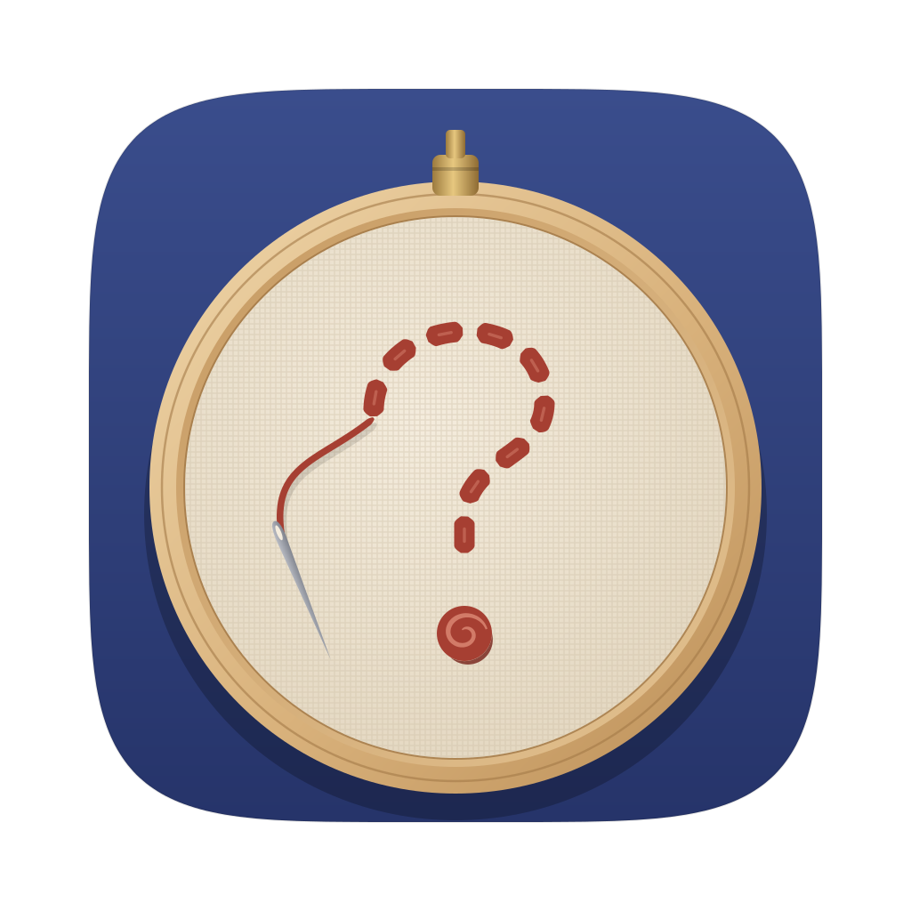
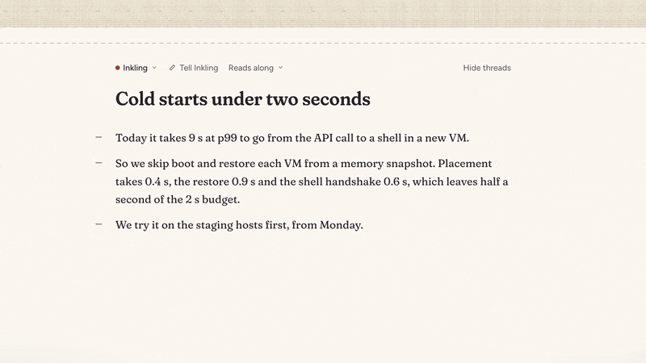

<p align="center">
  
</p>

# Inkling

Inkling is a notebook for your Mac that asks you questions. You write, and it reads along. When a line doesn't add up, it pulls a thread from those exact words out into the margin, with a question or a correction hanging on it. It never writes your notes for you. The thinking stays yours; Inkling only makes sure you have done it.

It runs on your own Claude subscription, through the Claude Code login already on your Mac. Your notebook is stored on your Mac as plain files. Inkling sends the text it needs to read or answer to Claude.

[Install Inkling](#install-and-run) · [Changelog](CHANGELOG.md)

## Watch it first

<a href="design/video/page/film.mp4"></a>

Sixteen seconds of the film, without sound: a line that doesn't add up gets a thread from those words, and the correction shows its working from your own numbers. GitHub doesn't play a video kept in the repo, so the whole film (1:13, with sound) is a file: click the picture, or open [`design/video/page/film.mp4`](design/video/page/film.mp4). It follows one note from its first sentence to a thread tied off, and every word from Inkling in it is real model output. What it shows, moment by moment, is in [`design/video/coverage.md`](design/video/coverage.md).

## What it's like to use

**You write, and it reads along.** When you pause, Inkling reads the paragraph you just finished. Most of the time it says nothing: a small stitch in the gutter shows it has read the paragraph and found nothing to ask. When something doesn't hold up, it sews a running stitch under the exact words and hangs a thread out to a tag in the margin, with a ? for a question or a × for a correction. A question that arrives while you are mid-sentence waits until you stop.

**Threads stay quiet until you look at them.** A tag stays folded until you rest the pointer on it, then drops open to show the question. Click it to write back, and the mind answers in the same thread. If you fix the words a thread is about, Inkling reads them again; when the problem is gone, the thread ties itself off and its knot joins the border at the top of the page. You can drag a tag anywhere on the page, jump between open threads with ⌥⌘↓ and ⌥⌘↑, or hide every thread with ⇧⌘. to see only your words.

**Every thread ends somewhere, and the ending is yours.** A correction always shows its working: the sum, made only from your own numbers, or your own words from elsewhere in the note; when it has neither, it asks instead. You settle a thread by fixing its words, by replying in its tag (and Write it in can put your reply under the paragraph, word for word, to rework), or by writing the answer anywhere else in the note, where a knot after your words ties it to the question. If you disagree, Let stand keeps your words, with a reason if you like, and no mind raises that point again, in any words. ⇧⌘B turns the note over: the back lists every thread it has had, oldest first, how each one ended, and the words before and after.

**You can ask whenever you want.** Select some words and press ⌘↩, and Inkling picks the one thing in them most worth a question. You can also ask your own question, or have it answer with a sketch that is stitched out step by step. Ask the room to hear from up to three minds at once, or start a sentence with a mind's name to call it directly. ⌘J opens a chat about the whole note. Ask yourself (⇧⌘↵) hangs your own question on your words, in ink, and no mind answers unless you call one in. In a note that waits to be asked, ⇧⌘R reads the whole draft once, paragraph by paragraph. For what you ask it, Inkling can look things up on the web, and it shows a source only when the page really says what it quotes.

**The minds have their own voices.** Inkling comes with a staff engineer, an editor, a skeptic, a Socratic tutor and an investor, and you can write your own: what it is for, how it thinks, its voice and how often it speaks. Each mind keeps its own thread colour, so you can see at a glance who asked what. Tell Inkling, above each note's title, says what that note is for, and a note can read along or wait to be asked.

**The window stays out of the way.** There is no toolbar. The few controls fade while you write and come back when you move the pointer. Settings is a proper Mac window, every keyboard shortcut can be changed, and you choose Linen (light) or Lamplight (dark), your thread colour, the lettering and the text size. Hold ⌥ to speak instead of typing.

**Your own blocks are sewn too.** Type `[ ] ` to start a checklist: a ticked item takes a cross-stitch and its line is tacked through. Type `> [!note] ` (or `warning`, or `tip`) for a callout, a patch sewn onto the page in the colour of its kind. Three backticks open a code block with line numbers, a Copy button and syntax in thread colours. Madder is Inkling's own colour: it never appears in your blocks or among the colours for your words, so you can always tell your marks from its questions.

**It is a real notebook.** Notes and folders live in the sidebar, ⌘K finds a note or starts one, ⇧⌘C copies a note as Markdown, and ⇧⌘E exports it as Markdown, HTML or Word, with its threads or without. File > Import from Obsidian brings in a whole vault, folders and all, and Inkling leaves the imported words alone so it reads only what you write afterwards. ⇧⌘K lists every open thread in the notebook, oldest first, each a keystroke from its words. And when something you write contradicts or depends on another note, Inkling asks on a thread that quotes both; ⌥⌘→ goes to the other end.

The complete list, row by row, is [`design/capabilities.md`](design/capabilities.md).

## What it believes

Inkling holds a few beliefs, written out in full in [`design/manifesto.md`](design/manifesto.md). You find out what you think by writing it down yourself, which is why Inkling never writes your notes for you. The most useful thing a reader can do is ask a good question in the right place, beside the exact words, and leave the answer to you. Most of what you write needs no comment, so Inkling's silence means something. And deciding that your words should stand is an answer too.

## Install and run

### Download the app

The release ZIP is for Apple Silicon Macs running macOS 13 or later. Install [Bun](https://bun.com/docs/installation) and [Claude Code](https://code.claude.com/docs/en/setup). For personal use, run `claude` in Terminal and sign in with `/login`.

1. Sign in to GitHub with access to this private repository. From [Releases](https://github.com/lolwierd/inkling/releases/latest), download `Inkling-<version>-macos-arm64.zip` and its matching `.zip.sha256` file.
2. In the download folder, run `shasum -a 256 -c Inkling-<version>-macos-arm64.zip.sha256`, replacing `<version>` with the version you downloaded. The ZIP should report `OK`.
3. Unzip it, move `Inkling.app` to Applications, and open it. Private builds use an ad hoc signature. If macOS blocks a verified download, follow [Apple’s instructions for opening a trusted app](https://support.apple.com/en-us/102445).

To update, quit Inkling and replace the app in Applications with the new one. Your notebook lives separately in `~/Library/Application Support/Inkling/`. Until the first release is published, build from source.

### Build from source

Install [Rust via rustup](https://rustup.rs), Bun and Claude Code. On a Mac without Xcode, install Apple’s Command Line Tools with `xcode-select --install` first.

```bash
git clone https://github.com/lolwierd/inkling.git
cd inkling
(cd brain && bun install --frozen-lockfile)
./scripts/bundle.sh release
open target/Inkling.app
```

The local bundle reads the brain from this checkout. Keep the checkout in place, or use `scripts/package.sh` on Apple Silicon to make a portable ZIP in `target/dist/`. With a recent Xcode, the bundle also gets the icon that follows macOS’s light, dark, clear and tinted styles.

The first time Inkling opens, Start here walks you through the notebook with threads to try. Help > Welcome Guide brings it back later.

## How it works

Inkling is two programs that talk over a pipe. The app, written in Rust with [GPUI](https://www.gpui.rs), draws the page, the threads and the margin, and keeps your notes. A small helper called the brain, written in TypeScript and run with Bun, talks to Claude through the Claude Agent SDK, using your Claude Code login. When you stop typing for a couple of seconds, the app sends the brain each paragraph you changed, together with the whole note, its threads, what the note is for and what Inkling knows about you, and the brain answers with silence, a question, a correction or a sketch. A paragraph it has read is not sent again until you change it, and a note that waits to be asked is never read on its own. After a read, Inkling looks through your other notes, on your Mac, for a passage the paragraph might contradict or depend on; only when one is close enough does it send one more call to compare the two.

Everything else happens only when you ask: a question about a selection, the room (one call for each mind), a reply in a tag, a sketch (two calls: the idea, then the drawing) and chat. You pick the model in Settings > Model, from the list Claude Code offers; reading along uses low effort and answering medium, and you can change either.

For what you ask it (Find a loose thread, a question about a selection, a mind called by name, a reply in a tag, chat), Inkling can look things up on the web, through the Agent SDK's WebSearch and WebFetch. Reading along at your pause never does: it stays one turn with no tools, and a fact it can't settle from the note becomes a question. Sketches, drawings, learning about you and comparing your notes never search either. The model searches only when a fact can't be settled from the note itself. A correction that cites a page keeps it only if a search in that same call returned the page and the quoted words are on it, which the brain checks by opening the page itself; otherwise the correction falls back to its arithmetic, your own words, or a question. Links in answers that no search returned are taken out. Searching uses more of your Claude plan: a call that searched used about $1.55 at API prices on 7 Nov, against $0.03 for one that doesn't, and took about 25 seconds. Nothing caps what a call spends. The one limit is eight turns, so a call can't go round in circles; one that runs out answers again without the web. Turn it off in Settings > Model > Look things up on the web, and every call is again a single turn with no tools; then nothing leaves your Mac except the text Inkling sends to Claude. With it on, searches built from your note also go out through Claude, and the brain opens the pages a correction cites.

## The look

The design is called Loose Threads, after embroidery: running stitches under your words, a thread that hangs with real rope physics, fabric tags, a knot when a thread is tied off, and a sampler border that grows as you work. The logo, Initial, marks the app the way linen was always marked as someone's own: a satin-stitched i, dotted with a French knot, inside a hemstitched border. The wordmark in the app carries the same i, in your thread colour. The type is Fraunces for writing and Figtree for the controls.

How the design was chosen, and the two directions it was chosen over, is in [`design/directions/DESIGN.md`](design/directions/DESIGN.md). The motion, the stitched diagrams and code blocks are explored in [`design/explorations/`](design/explorations/), and the logo rounds are in [`design/logo/`](design/logo/).

## Working on Inkling

Start with [`AGENTS.md`](AGENTS.md). It maps the code, lists the rules, and explains the one command that matters: `scripts/dev check` runs every check in about fifteen seconds. `scripts/dev e2e` drives the real app through scripted scenarios against a fake brain, so it makes no model calls, and `scripts/dev shot` takes a screenshot of the app without touching your screen.

GitHub Actions checks pull requests and pushes to `master`. See the [release runbook](docs/releasing.md) for preview builds, versions and tags.

| Where | What |
|---|---|
| `src/editor.rs` | The editor: blocks, marks, typing, undo, and the anchors that keep threads on their words |
| `src/note_page.rs` | The page: the reading loop, threads and tags, asking, sketches, chat |
| `src/stitch.rs` | The thread's rope physics, stitches, knots, the needle and the border |
| `src/settings.rs`, `src/shortcuts.rs` | The Settings window and every shortcut |
| `src/import.rs` | Import from Obsidian |
| `src/note_page/` | Each feature's own part of the page: answers in the note, Write it in, threads of your own, Read it through, the ends of threads between notes, going to a thread |
| `src/stand.rs`, `src/working.rs`, `src/back.rs`, `src/loose_ends.rs`, `src/between.rs` | Let it stand, Show its working, Turn it over, Loose ends, finding the other note |
| `brain/src/prompts.ts` | Every prompt Inkling sends to the model |

## A note on the Claude login

Anthropic's terms don't allow offering a claude.ai login inside products you ship to other people. Inkling is a personal tool that runs on your own machine with your own login, and it should stay that way. To share it, switch the brain to an API key: `INKLING_USE_API_KEY=1` keeps `ANTHROPIC_API_KEY` in its environment.

Fraunces and Figtree are used under the SIL Open Font License; the licence texts are in [`assets/fonts/`](assets/fonts/).
